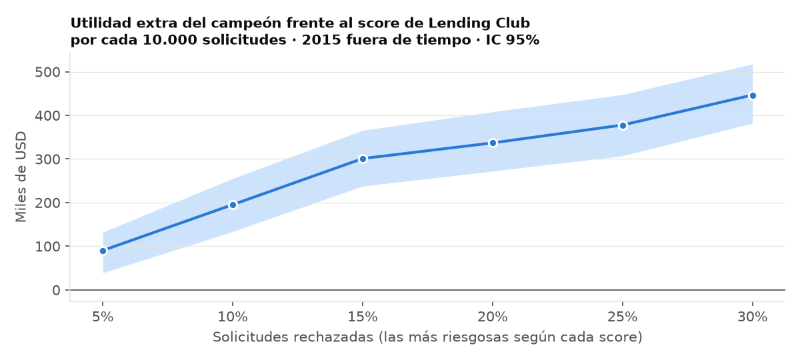

# credit-risk-agent-lab · English summary

> v1.0.0 · An end-to-end credit decision system built only on public Lending Club data. The full documentation, notebooks and the 21 design decisions are in Spanish: [README.md](README.md) · [docs/decisiones.md](docs/decisiones.md).

**In 30 seconds:**

- **Risk that pays:** a LightGBM model trained only on public application data ranks risk better than Lending Club's own score. At the same 20% rejection rate it adds **USD 337k of realized profit per 10,000 applications** (95% CI [272k; 408k], out of time on 2015 loans).
- **The whole decision, not just a score:** prepayment with a discrete-time survival model, economic loss, limit and pricing under a 20% payment-to-income cap, and a causal analysis of the effect of the rate on default, reported as a negative result.
- **AI agent with human control:** a LangGraph graph analyzes, decides and audits itself. It approves only clear-cut cases; rejections and counteroffers stay as proposals until an analyst signs them. Evaluated on 30 loans with known outcomes.

## Key results (out of time, 2015)

| Piece | Result |
|---|---|
| Risk | Champion LightGBM AUC 0.6823 vs 0.6784 for Lending Club's score, using only public application variables; 95% CI of the difference [+0.0016; +0.0063] |
| Model value | Ranking by the champion instead of by Lending Club's rate adds USD 195k (10% rejection), 337k (20%) and 447k (30%) of realized profit per 10,000 applications. Default barely moves (11.7% vs 11.9% at 20%): the gain comes from not rejecting expensive but good loans |
| Approval | An expected-utility policy matches the profit of a PD cutoff with a better ROI (6.30%) and lower default |
| Prepayment and loss | Discrete-time survival beats the alternatives (RMSE 0.0497); classic LGD has no signal |
| Limit and pricing | Loans Lending Club priced below the suggested rate returned 2.8% vs 6.7% for the rest |
| Causal inference | The rate–default link is selection, not causation: it vanishes within subgrade, but the placebo test fails, so the effect is not identified. A stress scenario flags 4.9% of applicants with no viable rate, who actually returned −1.3% with 31.5% default |
| Agent | Claude Haiku 5.5 on 30 cases with real outcomes: agrees with the engine's policy in 83% of cases, 100% hard-rule compliance, 94% of memo figures backed by a tool, 93% of audits passed on the first try and 97% on an Opus 5.5 judge, at USD 0.007 per application |

## Limits and fairness

- **The agent does not decide alone on cases that hurt the applicant.** Rejections and counteroffers pause the graph (LangGraph `interrupt`) until an analyst signs or returns them.
- **Fairness:** the public data has no sex, age or race, so direct discrimination cannot be measured. Proxy checks at a 20% rejection cut show calibration within ±0.5 points for every housing and region group, even rejection across regions (19.8%–20.1%), and disparate impact by housing (29% of renters rejected vs 11% of mortgage holders), in line with their real default (17.7% vs 12.1%). Housing correlates with age and income, so it would need monitoring in production.
- **Data:** only loans Lending Club approved (2012–2015); no rejected applications or offer acceptance data.
- **Small evals:** 30 cases catch large errors, not fine differences between versions.

## Stack

Python 3.14 · pandas · scikit-learn · LightGBM · XGBoost (CUDA) · PyTorch · Optuna · SHAP · survival analysis · two-way fixed effects · double machine learning · LangGraph · Claude (Anthropic SDK) · MCP · SQLite · LangSmith · pytest · GitHub Actions.

How to reproduce, the full pipeline and the agent commands are in the [Spanish README](README.md#cómo-reproducirlo).
