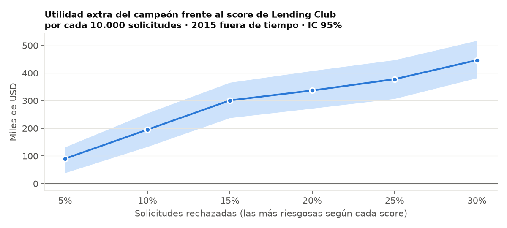
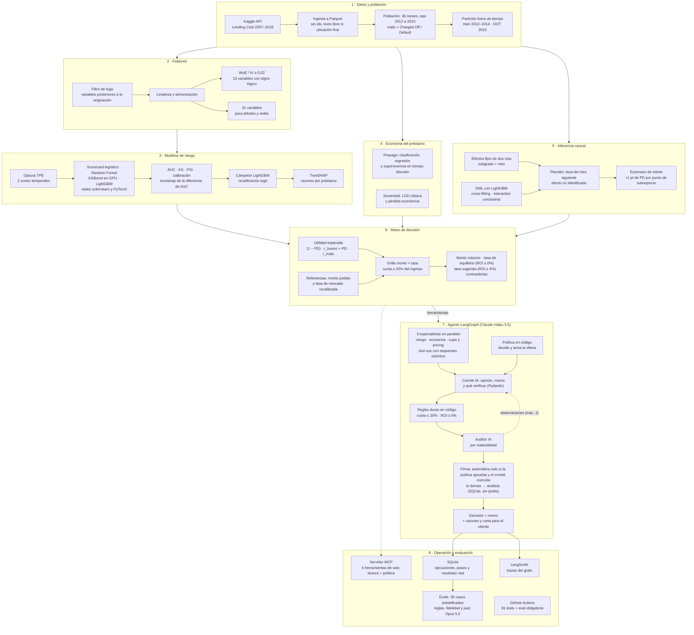

# credit-risk-agent-lab

> ✅ v1.1.0 · Proyecto construido sesión a sesión, con cada decisión registrada en [docs/decisiones.md](docs/decisiones.md). · [English summary](README.en.md)

**En 30 segundos:**

- **Riesgo que vale plata:** un LightGBM entrenado solo con datos públicos de la solicitud ordena el riesgo mejor que el score de Lending Club y, con la misma tasa de rechazo (20%), genera **+USD 337 mil de utilidad real por cada 10.000 solicitudes** (IC 95% [272; 408] mil, 2015 fuera de tiempo). Son 0,32% de los USD 104 M que se colocan y 4,7% más utilidad que ordenando por el score de Lending Club. Medido sobre la política que el sistema aplica de verdad y en neto, con costos supuestos, la política pierde USD 0,8 M menos que aprobar todo, pero no le gana a un corte simple por subgrado con el mismo rechazo (ver Límites).
- **Decisión completa, no solo un score:** prepago por supervivencia, pérdida económica, cupo y precio con capacidad de pago, y un análisis causal del efecto de la tasa que se reporta como resultado negativo.
- **Agente de IA con control humano:** la decisión la toma la política en código; un grafo en LangGraph con tres especialistas Claude analiza, un comité de IA da su opinión y redacta el memo, y un auditor lo revisa. Solo se aprueba solo lo que la política aprueba y el comité confirma; lo demás, incluidos los desacuerdos, lo firma un analista. Las razones para el cliente salen de un catálogo fijo, no del LLM.



## Pregunta de negocio

¿Se puede, **solo con un dataset público**, construir de punta a punta un sistema que tome **mejores decisiones de aprobación, cupo y precio**, y que **automatice el análisis y la decisión** con modelamiento avanzado, LLM y agentes?

## Resultados clave

| Pieza | Resultado (fuera de tiempo, 2015) | Decisión |
|---|---|---|
| Riesgo | El campeón LightGBM (AUC 0,6823) le gana al score de Lending Club (0,6784) solo con variables públicas de la solicitud; IC 95% de la diferencia [+0,0016; +0,0063] | 006–007 |
| Valor del modelo | Con la misma tasa de rechazo, ordenar por el campeón y no por la tasa de Lending Club suma +USD 195 mil (10% de rechazo), +337 mil (20%) y +447 mil (30%) de utilidad real por cada 10.000 solicitudes. La mora baja poco (11,7% frente a 11,9% al 20%): el valor viene de no rechazar préstamos caros pero buenos. En contexto: al 20% se colocan unos USD 104 M por cada 10.000 solicitudes (monto medio USD 12.806), así que +337 mil son 0,32% del monto colocado y 4,7% más utilidad que la regla de Lending Club (USD 7,16 M). El IC solo mide el ruido de la muestra de 2015, no un cambio de ciclo | 021 |
| Política real, en neto | Backtest en 10.000 solicitudes de jul–dic 2015: la política aprueba el 84,9%, contraoferta el 13,8% y rechaza el 1,3%. Con costos supuestos (fondeo 3% anual, USD 100 por préstamo, capital 10% al 12%), por cada 10.000 solicitudes: Lending Club aprobando todo −USD 1,48 M; la política −0,69 M si nadie acepta las contraofertas y −0,90 M si las acepta la mitad; un corte por subgrado con el mismo 15% de rechazo −0,50 M. La política mejora a aprobar todo, pero no a una regla simple por subgrado; con fondeo de 2% y USD 50 por préstamo todas quedan positivas. Los costos y la aceptación son supuestos (`credit_lab.valor`) | 023 |
| Aprobación | La política por utilidad esperada logra la misma utilidad que un corte por PD, con mejor ROI (6,30%) y menos mora | 008 |
| Prepago y severidad | La supervivencia en tiempo discreto predice el rendimiento mejor que las alternativas (RMSE 0,0497); la LGD clásica no tiene señal | 011 |
| Cupo y precio | Los préstamos que Lending Club cobró por debajo de la tasa sugerida rindieron 2,8% frente a 6,7%; los que pidieron más que el monto máximo, 1,8% con 30% de mora | 012–013 |
| Inferencia causal | La correlación tasa–mora (+1,51 pts por punto) se explica por el subgrado; el efecto causal de la tasa **no se pudo identificar**, porque el placebo falla con todos los métodos (también con wild cluster bootstrap y agrupando en dos vías: p < 0,001). El motor no supone ningún efecto y agrega un escenario de estrés, que es un supuesto: si la PD sube 0; 0,5; 1 o 2 pts por punto de sobreprecio, queda sin tasa de equilibrio el 0,1%, 0,4%, 1,6% o 2,2% de las solicitudes, con mora real de 67%, 40%, 37% y 36% | 014–015, 023 |
| Agente | Con Haiku 5.5, versión v3, en 35 casos con resultado real: coincide con la política en el 100%, 0 de 35 borradores del comité violan una regla dura, respalda con herramientas el 94% de las cifras del memo (un número al azar pasaría el 12% de las veces), pasa la auditoría al primer intento en el 100% y saca 98% en el juez (Opus 5.5), a USD 0,007 por solicitud. Con las mismas referencias, la v2 coincidía en el 80%: las evals mostraron que rechazaba contraofertas válidas y la regla 2b lo corrigió. En la v4 decide el código: la opinión del comité coincide con la política en 34 de 35 casos (97%, los 6 rechazos incluidos), 0 de 37 borradores violan una regla, fidelidad 94% y auditoría al primer intento 94%, a USD 0,008 por solicitud. El único desacuerdo (c07) iría al analista marcado. El juez de la v4 queda pendiente | 016–023 |

## Límites y equidad

- **El agente no decide solo los casos que afectan al cliente.** En crédito, un rechazo o un cambio de condiciones exige poder explicarlo y responder por él. La decisión la toma la política en código; se aprueba sola únicamente si la política aprueba, el comité de IA coincide y la auditoría pasa. Todo lo demás se pausa (`interrupt` de LangGraph) hasta que un analista lo firma o lo devuelve con un motivo de una lista cerrada; la firma queda en SQLite y se puede hacer después, desde otro proceso (decisiones 021–023). En el backtest, el 15,1% de las solicitudes iría a firma: 126–202 horas de analista por cada 10.000 solicitudes, a 5–8 minutos por caso.
- **Razones para el cliente:** salen de TreeSHAP y de un catálogo fijo (máximo 4), con una carta de aviso separada del memo interno. La antigüedad crediticia y otros proxies de edad, la región y la vivienda nunca se dan como razón.
- **Equidad:** los datos públicos no traen sexo, edad ni raza, así que no se puede medir discriminación directa. Se revisaron proxies con el corte de rechazo del 20% (`python -m credit_lab.valor`):
  - Calibración, medida solo en jul–dic 2015 (el ajuste del intercepto usó ene–jun): la PD queda a ±0,7 puntos de la mora real en cada grupo de vivienda y de región; ningún grupo queda castigado de más respecto de su riesgo.
  - Región: el rechazo es parejo (19,6% a 20,2%).
  - Vivienda: hay impacto dispar. Se rechaza al 29% de quienes arriendan frente al 11% de quienes tienen hipoteca, en línea con su mora real (17,4% frente a 12,0%). Con la política real el rechazo es bajo (1,7% frente a 0,8%), pero la razón 2,1 supera el umbral de 1,25 fijado de antemano; las subidas de tasa son raras (≤ 0,6% en todo grupo). Como la vivienda se correlaciona con la edad y el ingreso, en producción habría que monitorearla y justificarla.
  - Antigüedad crediticia (proxy de edad): no se usa como razón. Quitarla del modelo cuesta −0,0032 de AUC, casi toda la ventaja sobre el score de Lending Club; forzarla monótona (más antigüedad no sube el riesgo) cuesta −0,0011 (`python -m credit_lab.proxies`).
- **Datos:** préstamos aprobados por Lending Club entre 2012 y 2015. No hay rechazados ni datos de aceptación de ofertas, así que no se modela la demanda ni el sesgo de selección de la originación.
- **Evals pequeñas:** 35 casos sirven para detectar errores grandes, no para declarar diferencias finas entre versiones o modelos.
- **Costos supuestos:** el repo no tiene costos reales de fondeo, operación ni capital, ni datos de aceptación de contraofertas. El P&L neto usa supuestos explícitos con una tabla de sensibilidad; la tasa sugerida exige ROI ≥ 4% para cubrirlos (decisión 013).
- **Evals:** el juez no está calibrado con etiquetas humanas y la auditoría la hace el mismo modelo que redacta, así que no es una revisión independiente. Las fichas de los modelos y del agente están en [docs/fichas.md](docs/fichas.md).

## Diagrama

Cada capa nombra la técnica usada. El motor de decisión es la caja de herramientas de los especialistas del agente y del servidor MCP.



## Cómo reproducirlo

Requiere **Python 3.12 o superior** (el CI prueba 3.12 y 3.14). Las versiones exactas están en `requirements.txt`. Con GPU NVIDIA, instala torch desde el índice `cu128` (ver el comentario en ese archivo); XGBoost usa la GPU si la encuentra.

```bash
python -m venv .venv && .venv\Scripts\activate          # Windows (en Linux/macOS: source .venv/bin/activate)
pip install -r requirements.txt
pytest                                                   # 81 tests; no necesitan datos ni modelos
```

### Pipeline completo, en orden

| Paso | Comando | Qué produce |
|---|---|---|
| 1. Datos | `kaggle datasets download wordsforthewise/lending-club -f accepted_2007_to_2018Q4.csv.gz -p data/raw` | El crudo en `data/raw/` (si llega como `.zip`, descomprímelo ahí). Requiere tu token de Kaggle |
| 2. Ingesta | `python -m credit_lab.ingest` | `data/interim/accepted.parquet` |
| 3. Línea base (opcional) | Ejecutar `notebooks/04_logistica_scorecard.ipynb` | Scorecard logístico y su PD para comparar |
| 4. Retadores | `python -m credit_lab.ajustar 25` | 5 modelos ajustados con Optuna y sus predicciones de 2015 (`modelos/`) |
| 5. Campeón | `python -m credit_lab.campeon` | LightGBM recalibrado (`modelos/campeon.joblib`) |
| 6. Prepago y severidad | `python -m credit_lab.entrenar_economia` | Supervivencia y pérdida económica |
| 7. Referencias | `python -m credit_lab.referencias` | Monto pedido y tasa de mercado recalibrada |
| 8. Backtest de la política | `python -m credit_lab.backtest 1` (repetir hasta completar) | Política vigente y anterior, y estrés con 4 efectos, en 10.000 solicitudes (`data/interim/`); se guarda por etapas |
| 9. Valor y equidad | `python -m credit_lab.valor` | Utilidad extra, P&L neto de la política real, equidad en rechazo y precio y `docs/img/valor_campeon.png` |
| 10. Robustez (opcional) | `python -m credit_lab.causal` · `python -m credit_lab.proxies` | IC con wild bootstrap y dos vías (decisión 015); costo en AUC de los proxies de edad |

Los notebooks `01` a `11` documentan cada paso con sus gráficos y las conclusiones escritas por mí.

### Servidor MCP

Expone las herramientas del motor a cualquier cliente MCP. No necesita API key. Por ejemplo, en Claude Code:

```bash
claude mcp add credit-lab --env PYTHONPATH=<ruta-del-repo>/src -- <ruta-del-repo>/.venv/Scripts/python -m credit_lab.servidor_mcp
```

| Herramienta | Qué devuelve |
|---|---|
| `buscar_solicitud` | Índice y resumen de un préstamo de jul–dic 2015 |
| `consultar_riesgo` | PD del campeón y razones SHAP |
| `consultar_economia` | Rendimiento si sale bueno o malo, prepago y ROI esperado |
| `consultar_cupo_pricing` | Monto máximo, tasas de equilibrio y sugerida, contraofertas simuladas, estrés y capacidad de pago |
| `simular_oferta` | Métricas para otro monto (USD 1.000–35.000) y tasa (5%–30%); fuera de ese rango devuelve un error |
| `decidir` | Decisión de la política sin LLM, con la regla y la oferta |

### Agente

```bash
python -m credit_lab.agente --semilla 0    # requiere ANTHROPIC_API_KEY en .env (no se sube a git)
```

Si el caso no se aprueba solo, el comando muestra el memo y pide la firma del analista. Con `--pendiente` la deja para después e imprime su hilo; se firma con `python -m credit_lab.agente --firmar <hilo> --confirma --analista <nombre>` (o sin `--confirma` y con `--motivo` para devolverla). Cada ejecución queda registrada en `data/agente/ejecuciones.db` (SQLite, fuera de git) con su estado de firma y el resultado real del préstamo:

```python
from credit_lab import registro
with registro.conectar() as con:
    print(registro.resumen(con))   # mora y ROI real por decisión efectiva (sin pendientes ni devueltas)
    print(registro.kpis(con))      # % aprobado solo, % a firma, devueltas, desacuerdos y motivos del analista
```

Las trazas en LangSmith solo se envían si se piden: `--trazar` o `CREDIT_LAB_TRAZAR=1`, con `LANGSMITH_API_KEY` en el `.env`; el proyecto se llama `credit-risk-agent-lab`.

### Evals del agente

```bash
python -m credit_lab.evals casos                              # elige los 30 casos (gratis)
python -m credit_lab.evals rechazos                           # agrega 5 rechazos del motor (c30–c34, gratis)
python -m credit_lab.evals correr --modelo claude-haiku-5-5   # corre el agente (sin firma) y el juez sobre los casos pendientes
python -m credit_lab.evals reetiquetar                        # referencias con la política vigente (gratis)
python -m credit_lab.evals recalificar --version v2           # recalcula notas sin llamar a ningún modelo
python -m credit_lab.evals reporte --version v2               # evals/agente/<modelo>/<versión>/reporte.md
python -m credit_lab.evals verificar                          # falla si la versión por defecto no tiene su eval (CI)
```

Resultados, reportes y trazas de v0 a v3 publicados en [evals/agente](evals/agente). Cada versión se compara con la política con la que se construyó, y el reporte dice cuál es.

## Hoja de ruta

| Sesión | Tema | Entregable |
|---|---|---|
| 1 ✅ | Entorno + datos + definir el target | Datos descargados, decisión 001 |
| 2 ✅ | EDA y fuga de información (leakage) | Notebook con mis conclusiones, decisión 002 |
| 3 ✅ | Features: WoE, IV, partición fuera de tiempo | Pipeline de features + tests, decisión 003 |
| 4 ✅ | Línea base: regresión logística / scorecard | Modelo 1 + métricas, decisión 004 |
| 5 ✅ | Random Forest, XGBoost, LightGBM, red neuronal (scikit-learn y PyTorch) | Retadores con ajuste bayesiano, decisión 005 |
| 6 ✅ | Comparación: significancia (bootstrap), calibración, utilidad por punto de corte | Campeón LightGBM recalibrado, decisiones 006-007 |
| 7 ✅ | Explicabilidad (SHAP) y política de aprobación por utilidad esperada | Razones por préstamo, decisión 008 |
| 8 ✅ | Modelo de prepago (el "churn" del crédito) y severidad (LGD) | Supervivencia + pérdida económica, decisiones 009-011 |
| 9 ✅ | Motor de cupo óptimo y pricing (tasa mínima rentable) | Monto máximo y tasas de equilibrio y sugerida, decisiones 012-013 |
| 10 ✅ | **Inferencia causal**: efecto de la tasa en la mora (efectos fijos, placebo, DML) | Resultado negativo + escenario de estrés, decisiones 014-015 |
| 11 ✅ | Agente LangGraph: especialistas Claude en paralelo + comité + auditor | Agente funcionando con Claude Sonnet 5.5 (~USD 0,07 y ~30 s por solicitud), decisión 016 |
| 12 ✅ | Servidor MCP con las herramientas del motor (riesgo, economía, cupo/pricing, simulación) | Servidor `credit-lab`, decisión 017 |
| 13 ✅ | Registro de ejecuciones en SQLite + trazas en LangSmith (desempeño agéntico) | Ejecuciones registradas con su resultado real y trazadas, decisión 018 |
| 14 ✅ | **Evals del agente**: 30 casos con resultado real, calificación programada + juez Opus, versiones v0 → v2 con Haiku 5.5 | Concordancia 80% (83% con la referencia de entonces), fidelidad 94%, juez 97%, USD 0,007 por solicitud, decisión 019 |
| 15 ✅ | Regla 2b con ROI ≥ 4%, contraofertas verificables (v3), demo y publicación | Notebook 11, página del proyecto y release v1.0.0, decisión 020 |
| 16 ✅ | Revisión de cierre: firma humana en rechazos y contraofertas, valor en dinero, equidad, reproducibilidad y CI | Decisión 021 |
| 17 ✅ | Segunda revisión: doble llave en la aprobación, "escalar" ante auditoría fallida, evals de la v3, contexto del valor y Python 3.12 | Decisión 022 |
| 18 🟡 | Revisión técnica y de producto (issues #17–#47): el código decide, topes a las contraofertas, firma persistente, razones para el cliente, P&L neto, equidad en precio, robustez causal | Decisión 023; eval v4 sin juez |

## Decisiones y trade-offs

Ver [docs/decisiones.md](docs/decisiones.md).

## Licencia

MIT
