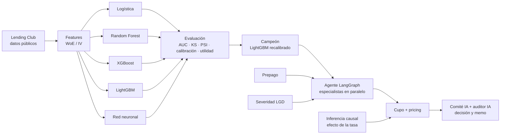

# credit-risk-agent-lab

> 🚧 En construcción. Proyecto de aprendizaje construido sesión a sesión.

**Motor de decisión de crédito** de punta a punta con datos públicos de **Lending Club**: se entrenan y comparan **6 modelos de riesgo** (regresión logística, Random Forest, XGBoost, LightGBM y dos redes neuronales) contra el score de Lending Club; el campeón se combina con modelos de **prepago** y **severidad (LGD)**, un **motor de cupo** y **pricing** validado con **inferencia causal** (efectos fijos, placebo y DML sobre el efecto de la tasa en la mora), y todo se orquesta con un **agente de IA en LangGraph** (especialistas en paralelo) que explica cada decisión, la audita y redacta el memo de crédito sin intervención humana.

## Pregunta de negocio

_🟡 Borrador por validar con Neider:_ ¿Puede un modelo entrenado solo con datos públicos de la solicitud **ordenar el riesgo mejor que el score de Lending Club**, y convertir esa ventaja en **mejores decisiones de aprobación, cupo y precio**?

## Diagrama



## Hoja de ruta

| Sesión | Tema | Entregable |
|---|---|---|
| 1 ✅ | Entorno + datos + definir el target | Datos descargados, decisión 001 |
| 2 ✅ | EDA y fuga de información (leakage) | Notebook con mis conclusiones, decisión 002 |
| 3 ✅ | Features: WoE, IV, partición fuera de tiempo | Pipeline de features + tests, decisión 003 |
| 4 ✅ | Línea base: regresión logística / scorecard | Modelo 1 + métricas, decisión 004 |
| 5 ✅ | Random Forest, XGBoost, LightGBM, red neuronal (scikit-learn y PyTorch) | Retadores con ajuste bayesiano, decisión 005 |
| 6 ✅ | Comparación: significancia (bootstrap), calibración, utilidad por punto de corte | Campeón LightGBM recalibrado, decisiones 006-007 |
| 7 ✅ | Explicabilidad (SHAP) y política de aprobación por utilidad esperada | Razones por préstamo, decisión 008 |
| 8 ✅ | Modelo de prepago (el "churn" del crédito) y severidad (LGD) | Supervivencia + pérdida económica, decisiones 009-011 |
| 9 ✅ | Motor de cupo óptimo y pricing (tasa mínima rentable) | Monto máximo y tasas de equilibrio y sugerida, decisiones 012-013 |
| 10 ✅ | **Inferencia causal**: efecto de la tasa en la mora (efectos fijos, placebo, DML) | Resultado negativo + escenario de estrés, decisiones 014-015 |
| 11 ✅ | Agente LangGraph 100% IA: especialistas Claude en paralelo + comité + auditor | Agente funcionando con Claude Sonnet 5.5 (~USD 0,07 y ~30 s por solicitud), decisión 016 |
| 12 ✅ | Servidor MCP con las herramientas del motor (riesgo, economía, cupo/pricing, simulación) | Servidor `credit-lab`, decisión 017 |
| 13 ✅ | Registro de ejecuciones en SQLite + trazas en LangSmith (desempeño agéntico) | Ejecuciones registradas con su resultado real y trazadas, decisión 018 |
| 14 | Evals del agente, demo y publicación | Release v1.0.0 |

## Decisiones y trade-offs

Ver [docs/decisiones.md](docs/decisiones.md).

## Cómo correrlo

```bash
python -m venv .venv && .venv\Scripts\activate      # Windows
pip install -r requirements.txt
python -m credit_lab.ingest                          # descarga Lending Club (requiere token de Kaggle)
pytest                                               # tests
```

### Servidor MCP

Expone las herramientas del motor a cualquier cliente MCP. No necesita API key. Por ejemplo, en Claude Code:

```bash
claude mcp add credit-lab --env PYTHONPATH=<ruta-del-repo>/src -- <ruta-del-repo>/.venv/Scripts/python -m credit_lab.servidor_mcp
```

| Herramienta | Qué devuelve |
|---|---|
| `buscar_solicitud` | Índice y resumen de un préstamo de jul–dic 2015 |
| `consultar_riesgo` | PD del campeón y razones SHAP |
| `consultar_economia` | Rendimiento si sale bueno o malo, prepago y ROI esperado |
| `consultar_cupo_pricing` | Monto máximo, tasas de equilibrio y sugerida, estrés y capacidad de pago |
| `simular_oferta` | Métricas para otro monto y tasa |

### Agente

```bash
python -m credit_lab.agente --semilla 0    # requiere ANTHROPIC_API_KEY en .env (no se sube a git)
```

Cada ejecución queda registrada en `data/agente/ejecuciones.db` (SQLite, fuera de git), con el resultado real del préstamo para evaluar las decisiones:

```python
from credit_lab import registro
with registro.conectar() as con:
    print(registro.resumen(con))   # mora y ROI real por decisión, auditoría, costo y latencia
```

Para ver las trazas del grafo en LangSmith, agrega `LANGSMITH_API_KEY` al `.env`; el proyecto se llama `credit-risk-agent-lab`.

## Licencia

MIT
