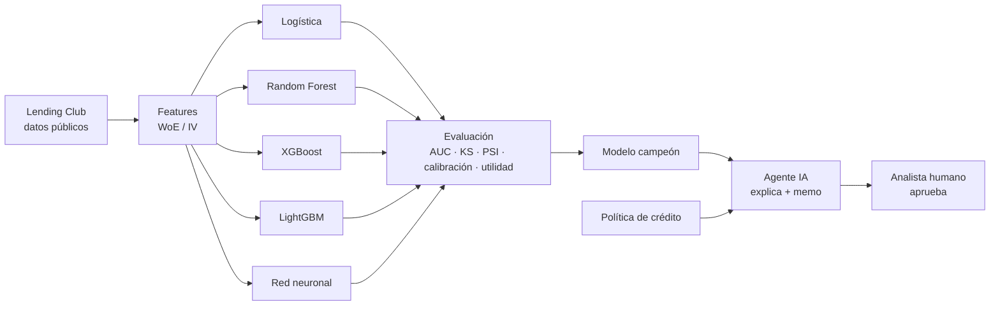

# credit-risk-agent-lab

> 🚧 En construcción. Proyecto de aprendizaje construido sesión a sesión.

Laboratorio de riesgo de crédito de punta a punta con datos públicos de **Lending Club**: se entrenan y comparan **5 familias de modelos** (regresión logística, Random Forest, XGBoost, LightGBM y una red neuronal), se elige un campeón con métricas de riesgo y de negocio, y se pone detrás de un **agente de IA** que explica cada decisión y redacta el memo de crédito.

## Pregunta de negocio

_(Pendiente: la escribe Neider en la sesión 1. Ver [docs/decisiones.md](docs/decisiones.md).)_

## Diagrama

## Hoja de ruta

| Sesión | Tema | Entregable |
|---|---|---|
| 1 ✅ | Entorno + datos + definir el target | Datos descargados, decisión 001 |
| 2 ✅ | EDA y fuga de información (leakage) | Notebook con mis conclusiones, decisión 002 |
| 3 ✅ | Features: WoE, IV, partición fuera de tiempo | Pipeline de features + tests, decisión 003 |
| 4 ✅ | Línea base: regresión logística / scorecard | Modelo 1 + métricas, decisión 004 |
| 5 ✅ | Random Forest, XGBoost, LightGBM, red neuronal (scikit-learn y PyTorch) | Retadores con ajuste bayesiano, decisión 005 |
| 6 ✅ | Comparación: significancia (bootstrap), calibración, utilidad por punto de corte | Campeón LightGBM recalibrado, decisiones 006-007 |
| 7 ✅ | Explicabilidad (SHAP) y política de aprobación por utilidad esperada | Razones por préstamo, decisión 008 |
| 8 | Agente: herramientas + memo de crédito | Agente funcionando |
| 9 | Servidor MCP, evals, demo y publicación | Release v1.0.0 |

## Decisiones y trade-offs

Ver [docs/decisiones.md](docs/decisiones.md).

## Cómo correrlo

_(Se completa al final.)_

## Licencia

MIT
