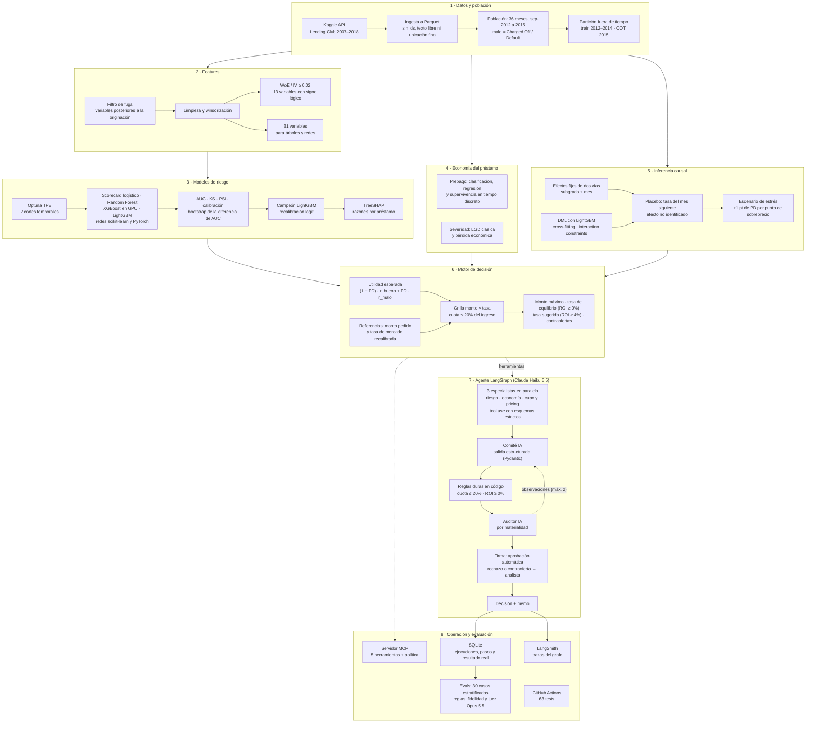

# credit-risk-agent-lab

> ✅ v1.0.0 · Proyecto construido sesión a sesión, con cada decisión registrada en [docs/decisiones.md](docs/decisiones.md). · [English summary](README.en.md)

**En 30 segundos:**

- **Riesgo que vale plata:** un LightGBM entrenado solo con datos públicos de la solicitud ordena el riesgo mejor que el score de Lending Club y, con la misma tasa de rechazo (20%), genera **+USD 337 mil de utilidad real por cada 10.000 solicitudes** (IC 95% [272; 408] mil, 2015 fuera de tiempo).
- **Decisión completa, no solo un score:** prepago por supervivencia, pérdida económica, cupo y precio con capacidad de pago, y un análisis causal del efecto de la tasa que se reporta como resultado negativo.
- **Agente de IA con control humano:** un grafo en LangGraph analiza, decide y se audita; aprueba solo los casos claros, y los rechazos y contraofertas quedan como propuesta hasta que un analista los firma. Evaluado en 30 casos con resultado real.


## Pregunta de negocio

¿Se puede, **solo con un dataset público**, construir de punta a punta un sistema que tome **mejores decisiones de aprobación, cupo y precio**, y que **automatice el análisis y la decisión** con modelamiento avanzado, LLM y agentes?

## Resultados clave

| Pieza | Resultado (fuera de tiempo, 2015) | Decisión |
|---|---|---|
| Riesgo | El campeón LightGBM (AUC 0,6823) le gana al score de Lending Club (0,6784) solo con variables públicas de la solicitud; IC 95% de la diferencia [+0,0016; +0,0063] | 006–007 |
| Valor del modelo | Con la misma tasa de rechazo, ordenar por el campeón y no por la tasa de Lending Club suma +USD 195 mil (10% de rechazo), +337 mil (20%) y +447 mil (30%) de utilidad real por cada 10.000 solicitudes. La mora baja poco (11,7% frente a 11,9% al 20%): el valor viene de no rechazar préstamos caros pero buenos | 021 |
| Aprobación | La política por utilidad esperada logra la misma utilidad que un corte por PD, con mejor ROI (6,30%) y menos mora | 008 |
| Prepago y severidad | La supervivencia en tiempo discreto predice el rendimiento mejor que las alternativas (RMSE 0,0497); la LGD clásica no tiene señal | 011 |
| Cupo y precio | Los préstamos que Lending Club cobró por debajo de la tasa sugerida rindieron 2,8% frente a 6,7%; los que pidieron más que el monto máximo, 1,8% con 30% de mora | 012–013 |
| Inferencia causal | La relación tasa–mora es selección, no causa: desaparece dentro del subgrado, pero el placebo falla, así que el efecto no queda identificado. El escenario de estrés detecta un 4,9% de clientes sin tasa viable que en la realidad rindieron −1,3% con 31,5% de mora | 014–015 |
| Agente | Con Haiku 5.5 en 30 casos con resultado real (versión v2): coincide con la política del motor en el 83% de los casos, cumple las reglas duras en el 100%, respalda con herramientas el 94% de las cifras del memo, pasa la auditoría al primer intento en el 93% y saca 97% en el juez (Opus 5.5), a USD 0,007 por solicitud. Los 5 desacuerdos fueron contraofertas del motor que el agente rechazó; la v3 corrige su causa y **no tiene eval propia** | 016–021 |

## Límites y equidad

- **El agente no decide solo los casos que afectan al cliente.** En crédito, un rechazo o un cambio de condiciones exige poder explicarlo y responder por él. El agente aprueba automáticamente solo lo que cumple la política; los rechazos y las contraofertas se pausan (`interrupt` de LangGraph) hasta que un analista los firma o los devuelve (decisión 021). Las evals miden la propuesta, sin firma.
- **Equidad:** los datos públicos no traen sexo, edad ni raza, así que no se puede medir discriminación directa. Se revisaron proxies con el corte de rechazo del 20% (`python -m credit_lab.valor`):
  - Calibración: la PD del campeón queda a ±0,5 puntos de la mora real en cada grupo de vivienda y de región; ningún grupo queda castigado de más respecto de su riesgo.
  - Región: el rechazo es parejo (19,8% a 20,1%).
  - Vivienda: hay impacto dispar. Se rechaza al 29% de quienes arriendan frente al 11% de quienes tienen hipoteca, en línea con su mora real (17,7% frente a 12,1%). Como la vivienda se correlaciona con la edad y el ingreso, en producción habría que monitorearla y justificarla.
- **Datos:** préstamos aprobados por Lending Club entre 2012 y 2015. No hay rechazados ni datos de aceptación de ofertas, así que no se modela la demanda ni el sesgo de selección de la originación.
- **Evals pequeñas:** 30 casos sirven para detectar errores grandes, no para declarar diferencias finas entre versiones o modelos.
- **Utilidad bruta:** no descuenta fondeo ni costos operativos; por eso la tasa sugerida exige ROI ≥ 4% (decisión 013).

## Diagrama

Cada capa nombra la técnica usada. El motor de decisión es la caja de herramientas de los especialistas del agente y del servidor MCP.



## Cómo reproducirlo

Requiere **Python 3.14**. Las versiones exactas están en `requirements.txt`. Con GPU NVIDIA, instala torch desde el índice `cu128` (ver el comentario en ese archivo); XGBoost usa la GPU si la encuentra.

```bash
python -m venv .venv && .venv\Scripts\activate          # Windows (en Linux/macOS: source .venv/bin/activate)
pip install -r requirements.txt
pytest                                                   # 63 tests; no necesitan datos ni modelos
```

### Pipeline completo, en orden

| Paso | Comando | Qué produce |
|---|---|---|
| 1. Datos | `kaggle datasets download wordsforthewise/lending-club -f accepted_2007_to_2018Q4.csv.gz -p data/raw` | El crudo en `data/raw/` (si llega como `.zip`, descomprímelo ahí). Requiere tu token de Kaggle |
| 2. Ingesta | `python -m credit_lab.ingest` | `data/interim/accepted.parquet` |
| 3. Línea base (opcional) | Ejecutar `notebooks/04_logistica_scorecard.ipynb` | Scorecard logístico y su PD para comparar |
| 4. Retadores | `python -m credit_lab.ajustar 25` | 5 modelos ajustados con Optuna y sus predicciones de 2015 (`modelos/`) |
| 5. Campeón | `python -m credit_lab.campeon` | LightGBM recalibrado (`modelos/campeon.joblib`) |
| 6. Prepago y severidad | `python -m credit_lab.entrenar_economia` | Supervivencia y pérdida económica |
| 7. Referencias | `python -m credit_lab.referencias` | Monto pedido y tasa de mercado recalibrada |
| 8. Valor y equidad | `python -m credit_lab.valor` | Utilidad extra por 10.000 solicitudes, revisión por grupos y `docs/img/valor_campeon.png` |

Los notebooks `01` a `11` documentan cada paso con sus gráficos y las conclusiones escritas por mí.

### Servidor MCP

Expone las herramientas del motor a cualquier cliente MCP. No necesita API key. Por ejemplo, en Claude Code:

```bash
claude mcp add credit-lab --env PYTHONPATH=<ruta-del-repo>/src -- <ruta-del-repo>/.venv/Scripts/python -m credit_lab.servidor_mcp
```

| Herramienta | Qué devuelve |
|---|---|
| `buscar_solicitud` | Índice y resumen de un préstamo de jul–dic 2015 |
| `consultar_riesgo` | PD del campeón y razones SHAP |
| `consultar_economia` | Rendimiento si sale bueno o malo, prepago y ROI esperado |
| `consultar_cupo_pricing` | Monto máximo, tasas de equilibrio y sugerida, contraofertas simuladas, estrés y capacidad de pago |
| `simular_oferta` | Métricas para otro monto y tasa |

### Agente

```bash
python -m credit_lab.agente --semilla 0    # requiere ANTHROPIC_API_KEY en .env (no se sube a git)
```

Si la propuesta es un rechazo o una contraoferta, el comando muestra el memo y pide la firma del analista antes de cerrar la decisión. Cada ejecución queda registrada en `data/agente/ejecuciones.db` (SQLite, fuera de git) con su estado de firma y el resultado real del préstamo:

```python
from credit_lab import registro
with registro.conectar() as con:
    print(registro.resumen(con))   # mora y ROI real por decisión, auditoría, costo y latencia
```

Para ver las trazas del grafo en LangSmith, agrega `LANGSMITH_API_KEY` al `.env`; el proyecto se llama `credit-risk-agent-lab`.

### Evals del agente

```bash
python -m credit_lab.evals casos                              # elige los 30 casos (gratis)
python -m credit_lab.evals correr --modelo claude-haiku-5-5   # corre el agente (sin firma) y el juez sobre los casos pendientes
python -m credit_lab.evals reporte --version v2               # evals/agente/<modelo>/<versión>/reporte.md
```

Resultados, reportes y trazas de v0, v1 y v2 publicados en [evals/agente](evals/agente).

## Hoja de ruta

| Sesión | Tema | Entregable |
|---|---|---|
| 1 ✅ | Entorno + datos + definir el target | Datos descargados, decisión 001 |
| 2 ✅ | EDA y fuga de información (leakage) | Notebook con mis conclusiones, decisión 002 |
| 3 ✅ | Features: WoE, IV, partición fuera de tiempo | Pipeline de features + tests, decisión 003 |
| 4 ✅ | Línea base: regresión logística / scorecard | Modelo 1 + métricas, decisión 004 |
| 5 ✅ | Random Forest, XGBoost, LightGBM, red neuronal (scikit-learn y PyTorch) | Retadores con ajuste bayesiano, decisión 005 |
| 6 ✅ | Comparación: significancia (bootstrap), calibración, utilidad por punto de corte | Campeón LightGBM recalibrado, decisiones 006-007 |
| 7 ✅ | Explicabilidad (SHAP) y política de aprobación por utilidad esperada | Razones por préstamo, decisión 008 |
| 8 ✅ | Modelo de prepago (el "churn" del crédito) y severidad (LGD) | Supervivencia + pérdida económica, decisiones 009-011 |
| 9 ✅ | Motor de cupo óptimo y pricing (tasa mínima rentable) | Monto máximo y tasas de equilibrio y sugerida, decisiones 012-013 |
| 10 ✅ | **Inferencia causal**: efecto de la tasa en la mora (efectos fijos, placebo, DML) | Resultado negativo + escenario de estrés, decisiones 014-015 |
| 11 ✅ | Agente LangGraph: especialistas Claude en paralelo + comité + auditor | Agente funcionando con Claude Sonnet 5.5 (~USD 0,07 y ~30 s por solicitud), decisión 016 |
| 12 ✅ | Servidor MCP con las herramientas del motor (riesgo, economía, cupo/pricing, simulación) | Servidor `credit-lab`, decisión 017 |
| 13 ✅ | Registro de ejecuciones en SQLite + trazas en LangSmith (desempeño agéntico) | Ejecuciones registradas con su resultado real y trazadas, decisión 018 |
| 14 ✅ | **Evals del agente**: 30 casos con resultado real, calificación programada + juez Opus, versiones v0 → v2 con Haiku 5.5 | Concordancia 83%, fidelidad 94%, juez 97%, USD 0,007 por solicitud, decisión 019 |
| 15 ✅ | Regla 2b con ROI ≥ 4%, contraofertas verificables (v3), demo y publicación | Notebook 11, página del proyecto y release v1.0.0, decisión 020 |
| 16 ✅ | Revisión de cierre: firma humana en rechazos y contraofertas, valor en dinero, equidad, reproducibilidad y CI | Decisión 021 |

## Decisiones y trade-offs

Ver [docs/decisiones.md](docs/decisiones.md).

## Licencia

MIT
