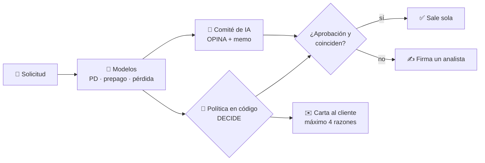
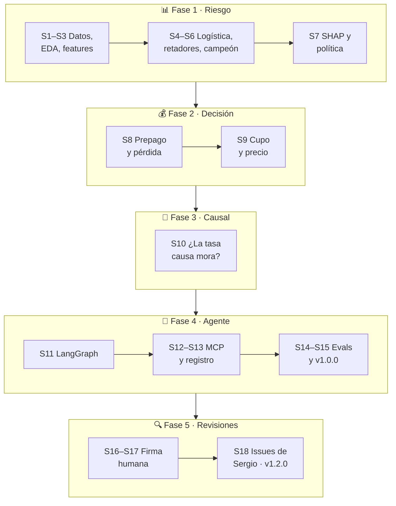
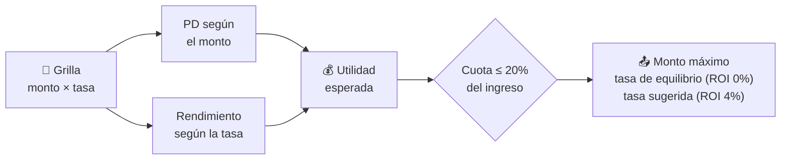
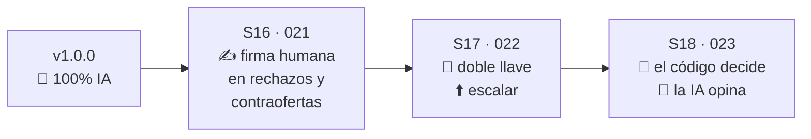
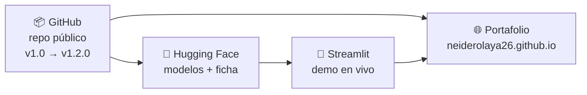

# 🧭 Guía del lab, paso a paso

> [!TIP]
> **Cómo leer esta guía.** Es la memoria del proyecto: qué se hizo, cómo y por qué, para retomarlo o contarlo en una entrevista. Cada sesión tiene los mismos bloques:
>
> - 🎯 **Qué hicimos**
> - 📚 **Para esto hay que saber…** los conceptos, en simple
> - ✅ **Lo que salió** el resultado
> - 📌 **Qué decidí** con enlace a la decisión en [decisiones.md](decisiones.md)
>
> No explico lo que ya se maneja en riesgo de crédito (PD, mora, WoE, IV, PSI, AUC, scorecard). Las palabras nuevas están en el [glosario](#10-glosario) al final.

**Contenido**

1. [La pregunta y la respuesta en una página](#1-la-pregunta-y-la-respuesta-en-una-página)
2. [Mapa del lab](#2-mapa-del-lab)
3. [Fase 1 · Datos y modelo de riesgo (sesiones 1–7)](#3-fase-1--datos-y-modelo-de-riesgo-sesiones-17)
4. [Fase 2 · Del score a la decisión (sesiones 8–9)](#4-fase-2--del-score-a-la-decisión-sesiones-89)
5. [Fase 3 · Inferencia causal (sesión 10)](#5-fase-3--inferencia-causal-sesión-10)
6. [Fase 4 · El agente de IA (sesiones 11–15)](#6-fase-4--el-agente-de-ia-sesiones-1115)
7. [Fase 5 · Las revisiones (sesiones 16–18)](#7-fase-5--las-revisiones-sesiones-1618)
8. [Publicación](#8-publicación)
9. [Cómo retomarlo](#9-cómo-retomarlo)
10. [Glosario](#10-glosario)
11. [Lo que quedó abierto](#11-lo-que-quedó-abierto)

---

## 1. La pregunta y la respuesta en una página

**La pregunta:** ¿se puede, solo con un dataset público, construir de punta a punta un sistema que tome mejores decisiones de **aprobación, cupo y precio**, y que automatice el análisis y la decisión con modelamiento avanzado, LLM y agentes?

**La respuesta corta:** sí, con matices.

- ✅ El modelo de riesgo le gana al score de Lending Club solo con datos públicos de la solicitud.
- ✅ El motor decide aprobación, monto y tasa, y un agente de IA analiza, opina y redacta el memo.
- ⚠️ Medida en neto y con costos dummy, la política **no le gana a un corte simple por subgrado**.
- ⚠️ El efecto causal de la tasa en la mora **no se pudo identificar**.

Así funciona hoy una solicitud:



---

## 2. Mapa del lab

18 sesiones entre el 30-oct y el 13-nov de 2026, en cinco fases:



---

## 3. Fase 1 · Datos y modelo de riesgo (sesiones 1–7)

### Sesión 1 · Población, objetivo y contra quién competir

🎯 **Qué hicimos:** descargamos Lending Club desde Kaggle (2,26 M préstamos aprobados entre 2007 y 2018) y definimos qué se modela.

📚 **Para esto hay que saber…**

- **Sesgo de censura:** los préstamos recientes no han terminado. Entre los terminados de 2016–2017 la mora sale ~20%, frente a ~14% en los años maduros, porque los que terminan antes son los que caen. Por eso se usan solo años **maduros**.
- **Campeón vs. retador:** la tasa (`int_rate`) que puso Lending Club resume su propio score. En vez de usarla como variable, se usa como **el modelo a vencer**.
- **Fuera de tiempo (OOT):** se entrena con el pasado y se evalúa en un año que el modelo nunca vio, como pasa en producción.

✅ **Lo que salió:** préstamos a 36 meses de 2012–2015. Malo = *Charged Off* o *Default*. Entrenamiento 2012–2014 y examen final en 2015.

📌 **Qué decidí:** [decisión 001](decisiones.md#001--población-variable-objetivo-y-benchmark).

### Sesión 2 · EDA y fuga de información

🎯 **Qué hicimos:** revisamos cada variable buscando señal y **fugas** (variables que se conocen después de dar el crédito, como los pagos o el FICO más reciente).

✅ **Lo que salió:**

- La mejor variable propia, el FICO, tiene un IV de 0,13, frente a 0,29–0,31 del score de Lending Club. Ganarle no iba a ser fácil.
- La mora previa casi no predice (IV ≈ 0) por **sesgo de selección**: Lending Club ya rechazó a los que tenían mucha mora, así que entre los aprobados casi no hay.
- Dos listas de variables: 16 para la logística (IV ≥ 0,02) y 31 para los árboles y la red, que pueden aprovechar interacciones.

📌 **Qué decidí:** [decisión 002](decisiones.md#002--selección-de-variables-por-familia-de-modelo).

### Sesión 3 · Features, WoE y estabilidad

🎯 **Qué hicimos:** armamos el pipeline de variables con tests y medimos la estabilidad entre el entrenamiento y 2015.

✅ **Lo que salió:** 7 variables de buró tenían un PSI de ~0,84, una alarma enorme. No era que los clientes cambiaran: Lending Club empezó a reportar esas variables a mediados de 2012, así que antes venían vacías. Sin contar los nulos, el PSI era < 0,01.

📌 **Qué decidí** ([decisión 003](decisiones.md#003--inicio-del-entrenamiento-en-septiembre-de-2012)): el entrenamiento empieza en **sep-2012**. Quedan 283.253 préstamos de entrenamiento (13,2% malos) y 283.026 de 2015 (14,9% malos), con un PSI máximo de 0,036.

### Sesión 4 · Línea base: scorecard logístico

🎯 **Qué hicimos:** una regresión logística sobre WoE, el modelo clásico de la industria, como piso de comparación.

✅ **Lo que salió:** tres variables salieron con el signo contrario a la lógica por **multicolinealidad** (estaban casi duplicadas con otras). Al quitarlas, el AUC pasó de 0,6534 a 0,6526: casi nada, a cambio de un modelo que se puede defender.

📌 **Qué decidí:** [decisión 004](decisiones.md#004--variables-con-signo-contrario-a-la-lógica-en-la-logística).

### Sesión 5 · Retadores con optimización bayesiana

🎯 **Qué hicimos:** cuatro retadores (Random Forest, XGBoost, LightGBM y una red neuronal en scikit-learn y PyTorch), todos con el mismo esfuerzo de ajuste.

📚 **Para esto hay que saber…**

- **Optimización bayesiana (Optuna, TPE):** en vez de probar hiperparámetros al azar, cada intento aprende de los anteriores y busca donde es más probable mejorar. Se dieron 25 intentos por modelo.
- **Dos cortes temporales:** cada combinación se validó en dos trimestres distintos de 2014. Si solo funciona en uno, es suerte. **2015 nunca se tocó** durante el ajuste.

✅ **Lo que salió:** con los parámetros por defecto, XGBoost (0,6792) y LightGBM (0,6788) apenas empataban con la tasa de Lending Club (0,6784). Hacía falta ajustarlos.

📌 **Qué decidí:** [decisión 005](decisiones.md#005--ajuste-de-hiperparámetros-con-optimización-bayesiana).

### Sesión 6 · El campeón y su recalibración

🎯 **Qué hicimos:** comparamos los modelos con significancia estadística y revisamos la calibración.

📚 **Para esto hay que saber…**

- **Bootstrap pareado:** se remuestrea 2015 300 veces y se mide la diferencia de AUC en cada réplica. Si el intervalo no cruza cero, la ventaja es real y no ruido.
- **Ordenar ≠ calibrar:** un modelo puede ordenar bien el riesgo y aun así decir 13% de PD cuando la mora real es 15%. Para decidir y para cobrar importa el nivel.

✅ **Lo que salió:**

- **LightGBM es el campeón:** +0,0039 de AUC sobre Lending Club, IC 95% [+0,0016; +0,0063]. AUC de 0,6823 frente a 0,6784. Con XGBoost empató.
- 2015 fue un año más riesgoso, así que su PD media era 13,1% frente a 14,9% real. Se corrigió con un **desplazamiento del intercepto** aprendido en ene–jun 2015 y evaluado en jul–dic: PD 14,5% frente a 14,7% real, sin tocar el orden.

📌 **Qué decidí:** [decisión 006](decisiones.md#006--modelo-campeón-lightgbm) y [decisión 007](decisiones.md#007--recalibración-del-campeón).

### Sesión 7 · Explicar y aprobar por utilidad

🎯 **Qué hicimos:** razones por préstamo con SHAP y una política de aprobación que piensa en plata, no solo en PD.

📚 **Para esto hay que saber…**

- **SHAP (TreeSHAP):** reparte la predicción de un préstamo entre sus variables. Por ejemplo: "el FICO bajo sumó tanto al riesgo y el ingreso alto restó tanto".
- **Utilidad esperada:** `monto × [(1 − PD) × lo que rinde si paga + PD × lo que se pierde si no]`. Un préstamo bueno rinde de +8% (A1) a +31% (F/G), y uno malo pierde ~36% en cualquier subgrado. Por eso la PD tolerable sube con el precio: ~18% en A1 y ~48% en G2.

✅ **Lo que salió:** aprobar si la utilidad esperada es positiva da la misma utilidad que un corte por PD, con mejor ROI (6,30%) y menos mora.

📌 **Qué decidí:** [decisión 008](decisiones.md#008--política-de-aprobación-por-utilidad-esperada).

---

## 4. Fase 2 · Del score a la decisión (sesiones 8–9)

📌 Aquí decidí ampliar el alcance: una PD sola no decide un crédito ([decisión 009](decisiones.md#009--alcance-motor-de-decisión-de-crédito-completo)).

### Sesión 8 · Prepago y severidad

🎯 **Qué hicimos:** modelamos **cuánto rinde** un préstamo bueno (porque muchos prepagan) y **cuánto se pierde** con uno malo. Construimos todas las opciones y elegimos con evidencia.

📚 **Para esto hay que saber…**

- **Prepago, el "churn" del crédito:** solo el 35% de los buenos llega al final del plazo. El que prepaga antes del mes 30 rinde 13,1% del monto, frente a 20,5% del que paga completo.
- **Supervivencia en tiempo discreto:** en vez de preguntar "¿prepaga sí o no?", estima la probabilidad de terminar de pagar en cada mes. Así sale la distribución completa del mes de pago.
- **LGD clásica vs. pérdida económica:** la LGD de Basilea mira cuánto del saldo se pierde. La pérdida económica mira cuánto se perdió del monto prestado, contando lo que alcanzó a pagar.

✅ **Lo que salió:**

- La supervivencia ganó en prepago, con un RMSE de 0,0497 frente a 0,054–0,056 de las otras opciones.
- La LGD clásica **no tiene señal**: el 92% está entre 80% y 100%, y usarla empeora la utilidad. La pérdida económica tiene algo de señal.

📌 **Qué decidí:** [decisión 010](decisiones.md#010--prepago-y-severidad-construir-todas-las-opciones-y-elegir-con-evidencia) y [decisión 011](decisiones.md#011--prepago-por-supervivencia-y-severidad-por-pérdida-económica).

### Sesión 9 · Motor de cupo y precio

🎯 **Qué hicimos:** un simulador que, para cada cliente, prueba montos de USD 1.000 a 35.000 y tasas de 5% a 30%, y calcula la utilidad de cada combinación.

📚 **Para esto hay que saber…** una regresión del monto aprende **lo que pide el cliente**, y una de la tasa aprende **lo que cobraba Lending Club**. Ninguna dice cuánto es seguro prestar. Por eso el simulador decide y las regresiones quedan solo como referencia de mercado.



✅ **Lo que salió:**

- Los préstamos que Lending Club cobró por debajo de la tasa sugerida rindieron 2,8%, frente a 6,7% del resto.
- Los que pidieron más que el monto máximo rindieron 1,8% y tuvieron 30% de mora.

📌 **Qué decidí:** [decisión 012](decisiones.md#012--motor-de-cupo-y-pricing-simulador--regresiones-de-referencia) (cuota ≤ 20%) y [decisión 013](decisiones.md#013--umbrales-de-pricing-equilibrio-0-y-objetivo-4) (ROI objetivo del 4%).

---

## 5. Fase 3 · Inferencia causal (sesión 10)

🎯 **Qué hicimos:** respondimos si **subir la tasa causa más mora**. Si fuera así, el precio sugerido estaría subestimando el riesgo.

📚 **Para esto hay que saber…**

- **Correlación no es causa:** a más tasa, más mora, pero puede ser porque a los riesgosos se les cobra más (**selección**), no porque la tasa los hunda.
- **Experimento natural:** dentro de un mismo subgrado, el 96,3% de la variación de la tasa lo explica el mes, porque Lending Club cambiaba sus tablas en fechas distintas para cada subgrado. Dos clientes iguales pagaban tasas distintas solo por la fecha.
- **Efectos fijos de dos vías:** comparan dentro del subgrado y dentro del mes, para aislar el cambio de tabla.
- **Placebo:** se "aplica" el tratamiento donde no debería haber efecto. Si igual aparece un efecto, el diseño está contaminado.
- **DML (double machine learning):** usa modelos de ML para limpiar las variables de control y estimar solo el efecto de la tasa.

✅ **Lo que salió:**

- La correlación tasa–mora (+1,51 pts por punto) **desaparece dentro del subgrado**.
- **El placebo falla con todos los métodos:** un mes antes de cada subida, el subgrado ya traía ~6,7 pts menos de FICO por punto de tasa. Lending Club subía tasas **reaccionando** a cómo empeoraba cada subgrado, así que el efecto no se puede identificar.
- Se confirmó en la sesión 18 con wild cluster bootstrap y agrupación en dos vías (p < 0,001).

📌 **Qué decidí** ([decisión 014](decisiones.md#014--efecto-causal-de-la-tasa-sesión-10-completa) y [decisión 015](decisiones.md#015--el-efecto-de-la-tasa-no-se-identifica-pd-fija--escenario-de-estrés)): reportar el resultado negativo y mantener la PD fija ante la tasa. Agregué:

- una **tasa de mercado** de referencia;
- una bandera **"fuera de rango"**, que se activa cuando la tasa se aleja más de 1 pt de la de mercado;
- un **escenario de estrés** opcional, en el que la PD sube 1 pt por cada punto de sobreprecio. Es un supuesto, no una estimación.

> [!IMPORTANT]
> Un resultado negativo bien documentado vale más que un número causal inventado. Es de lo que más se valora en una entrevista.

---

## 6. Fase 4 · El agente de IA (sesiones 11–15)

### Sesión 11 · El agente en LangGraph

🎯 **Qué hicimos:** un grafo en LangGraph con tres especialistas Claude en paralelo (riesgo, economía y cupo/precio), un comité que consolida y un auditor que revisa.

📚 **Para esto hay que saber…**

- **LangGraph:** arma un flujo de pasos (nodos) con estado compartido. Permite pasos en paralelo, ciclos (el auditor devuelve el caso al comité) y pausas para un humano.
- **Herramientas (tools):** el LLM no inventa números. Llama funciones de Python que corren los modelos del repo, y cada cifra del memo sale de ahí.
- **Reglas duras:** límites en código que ningún LLM puede saltarse, como la cuota ≤ 20% o el rechazo si el ROI < 0%.

✅ **Lo que salió:** el agente funcionando con Claude Sonnet, a ~USD 0,07 y ~30 s por solicitud. La versión original era **100% IA, sin humano**; eso cambió en las revisiones.

📌 **Qué decidí:** [decisión 016](decisiones.md#016--agente-100-ia-especialistas-con-llm--comité--auditor).

### Sesiones 12–13 · Servidor MCP y registro

🎯 **Qué hicimos:** expusimos las herramientas del motor por **MCP** y guardamos cada ejecución.

📚 **Para esto hay que saber…**

- **MCP (Model Context Protocol):** un estándar para que cualquier cliente de IA, como Claude Code u otro agente, use las mismas herramientas. Hoy son 6, todas de solo lectura: riesgo, economía, cupo y precio, simular oferta, política y decidir.
- **SQLite + LangSmith:** SQLite guarda cada decisión con el **resultado real** del préstamo, así que se puede medir si el agente gana plata y no solo si redacta bien. LangSmith muestra la traza de cada paso y cada llamada al LLM.

📌 **Qué decidí:** [decisión 017](decisiones.md#017--sesión-12-servidor-mcp-del-motor) y [decisión 018](decisiones.md#018--registro-de-ejecuciones-en-sqlite--trazas-en-langsmith).

### Sesión 14 · Evals del agente

🎯 **Qué hicimos:** medir si el agente decide bien, con 30 préstamos de 2015 con resultado real conocido.

📚 **Para esto hay que saber…**

- **Eval:** un examen fijo que se repite en cada versión del agente, para comparar con evidencia y no por impresión.
- **Calificación programada:** código que revisa la concordancia con la política, si se cumplen las reglas duras y la **fidelidad** (cuántas cifras del memo coinciden con una herramienta).
- **Juez LLM:** otro modelo (Opus) califica el memo con una rúbrica. Es útil, pero hay que calibrarlo con etiquetas humanas (pendiente, #21).
- **Piso al azar:** un número inventado pasaría la prueba de fidelidad el 12% de las veces. Por eso un 94% sí significa algo.

✅ **Lo que salió:** el piloto (v0) fue un desastre útil. El auditor nunca aprobaba porque cada agente veía datos distintos. Al corregir el diseño, con el mismo Haiku:

| Versión | Concordancia | Auditoría al 1er intento |
|---|---|---|
| v0 | 0% | 0% |
| v2 | 80% | 93% |
| v3 (sesión 15) | 100% | 100% |

📌 **Qué decidí** ([decisión 019](decisiones.md#019--evals-del-agente-30-casos-calificación-programada--juez-haiku-antes-que-sonnet)): usar Haiku antes que Sonnet, porque es ~20 veces más barato (USD 0,007 por solicitud).

### Sesión 15 · Regla 2b, demo y v1.0.0

🎯 **Qué hicimos:** las evals mostraron que el agente rechazaba contraofertas válidas. Corregimos la política y publicamos.

✅ **Lo que salió:**

- **Regla 2b:** la contraoferta por monto exige ROI ≥ 4%.
- La herramienta de cupo ahora entrega las contraofertas ya simuladas, para que el agente las pueda verificar.
- Notebook 11 con la demo, página del proyecto y **release v1.0.0**.

📌 **Qué decidí:** [decisión 020](decisiones.md#020--cierre-regla-2b-con-roi--4-contraofertas-verificables-demo-y-release).

---

## 7. Fase 5 · Las revisiones (sesiones 16–18)

Tres rondas de revisión cambiaron el diseño de fondo:



### Sesión 16 · Firma humana, valor en dinero y equidad

🎯 **Qué hicimos:** revisamos el proyecto pensando en producción en una financiera.

✅ **Lo que salió:**

- **"100% IA, sin humano" es una alarma en crédito**, por el gobierno de modelos, la explicación de rechazos y el crédito justo. Los rechazos y las contraofertas ahora se pausan (`interrupt` de LangGraph) hasta que un analista firma.
- **Valor en dinero:** con la misma tasa de rechazo (20%), ordenar por el campeón en vez de por la tasa de Lending Club suma **+USD 337 mil de utilidad real por cada 10.000 solicitudes** (IC 95% [272; 408] mil). El valor viene de no rechazar préstamos caros pero buenos.
- **Equidad por proxies**, porque los datos no traen sexo, edad ni raza.
- **Reproducibilidad:** pipeline documentado, versiones fijas y CI en GitHub Actions.

📌 **Qué decidí** ([decisión 021](decisiones.md#021--revisión-de-cierre-firma-humana-valor-en-dinero-equidad-y-reproducibilidad)): *"En todos los modelos existe una zona gris… y ahí es prudente hacer un doble check con el factor humano."*

### Sesión 17 · Doble llave y "escalar"

✅ **Lo que salió:**

- **Doble llave:** una aprobación sale sola solo si el comité **y** la política en código aprueban.
- **Escalar:** si la auditoría falla dos veces, el caso no se convierte en rechazo. Va al analista como "escalar".
- Eval de la v3 en 35 casos (se agregaron 5 rechazos): 100% de concordancia y 98% en el juez.

📌 **Qué decidí:** [decisión 022](decisiones.md#022--doble-llave-en-la-aprobación-y-escalar-cuando-la-auditoría-falla).

### Sesión 18 · La revisión de Sergio (issues #17–#47)

🎯 **Qué hicimos:** Sergio Mora Pardo revisó el repo como un equipo de ciencia de datos y un product manager de crédito, y dejó 31 issues priorizados. Atendimos 26 en el PR #48.

✅ **Lo que salió:**

| Tema | Antes | Después |
|---|---|---|
| Quién decide | el comité de IA | **la política en código**; la IA opina y sus desacuerdos van a firma |
| Contraofertas | la tasa podía subir sin tope (+3,11 pts en un caso) | primero se baja el monto y la tasa sube **como máximo +2 pts** |
| Firma | en memoria, se perdía al cerrar | **SQLite**, sobrevive y se puede firmar después |
| Razones al cliente | las escribía el LLM | **catálogo fijo** de máximo 4, sin proxies de edad |
| Valor | +337 mil en un corte que no se aplicaba, en bruto | **backtest de la política real, en neto** |
| Evals | la v2 se comparaba con una referencia vieja | referencia por versión y **eval obligatoria en CI** |

**Los resultados honestos:**

- **Backtest de 10.000 solicitudes de jul–dic 2015:** 84,9% aprueba, 13,8% contraoferta y 1,3% rechaza. El 15,1% va a firma, entre 126 y 202 horas de analista.
- **P&L neto con costos dummy** (fondeo 3%, USD 100 por préstamo y capital 10% al 12%; ilustrativos, no reales): la política pierde USD 0,8 M menos que aprobar todo, pero **no le gana a un corte por subgrado**.
- **Equidad:** calibración a ±0,7 pts por grupo. Quitar los proxies de edad cuesta −0,0032 de AUC.
- **Eval v4:** la opinión del comité coincide con la política en 34 de 35 casos (97%), con USD 0,29 en total.

📌 **Qué decidí** ([decisión 023](decisiones.md#023--el-código-decide-topes-a-las-contraofertas-y-pl-de-la-política-real)): *"En crédito la decisión tiene que ser explicable y repetible… eso lo garantiza el código, no un LLM."*

---

## 8. Publicación



| Dónde | Qué hay | Enlace |
|---|---|---|
| GitHub | código, notebooks, decisiones y releases | [credit-risk-agent-lab](https://github.com/neiderolaya26/credit-risk-agent-lab) |
| Hugging Face | los 4 modelos del motor y su ficha | [credit-risk-lending-club](https://huggingface.co/neiderolaya26/credit-risk-lending-club) |
| Streamlit | demo: 200 solicitudes de 2015, sin LLM | [credit-risk-agent-lab.streamlit.app](https://credit-risk-agent-lab.streamlit.app/) |
| Portafolio | ficha del proyecto en español e inglés | [neiderolaya26.github.io](https://neiderolaya26.github.io/es/work/credit-risk-agent-lab/) |

📚 **Para esto hay que saber…**

- **Hugging Face Hub:** el "GitHub de los modelos". Se publica el modelo con su **ficha** (datos, métricas, límites y uso previsto).
- **Por qué Streamlit y no un Space de Hugging Face:** desde 2026, los Spaces de Gradio piden la suscripción PRO, y Streamlit Community Cloud es gratis. La demo descarga los modelos de Hugging Face, así que las dos plataformas trabajan juntas.
- **Streamlit Community Cloud:** se conecta al repo de GitHub y cada push a `main` actualiza la app sola. Se duerme tras días sin visitas y tarda ~30 s en despertar.

---

## 9. Cómo retomarlo

```bash
# entorno (Python 3.12+; en Windows PYTHONPATH usa ";")
python -m venv .venv && .venv\Scripts\activate
pip install -r requirements.txt
pytest                                            # 81 tests, sin datos ni modelos

# la demo en local
pip install -r demo/requirements.txt
streamlit run demo/streamlit_app.py

# el agente sobre una solicitud (usa la API de Anthropic)
python -m credit_lab.agente --pendiente           # deja la firma para después
python -m credit_lab.agente --firmar <hilo> --confirma --analista <nombre>

# evals (verificar es gratis; correr gasta saldo)
python -m credit_lab.evals verificar
```

| Para… | Mira |
|---|---|
| el pipeline completo, paso a paso | [README → Cómo reproducirlo](../README.md#cómo-reproducirlo) |
| el porqué de cada decisión | [decisiones.md](decisiones.md) |
| métricas y límites de los modelos y del agente | [fichas.md](fichas.md) |
| volver a publicar los modelos | `python -m credit_lab.publicar_hf publicar` (pide `HF_TOKEN` en `.env`) |

> [!WARNING]
> Los modelos `.joblib` solo cargan con las mismas versiones de pandas, scikit-learn y LightGBM con que se guardaron (las de `requirements.txt`).

---

## 10. Glosario

| Término | En simple |
|---|---|
| **OOT** (fuera de tiempo) | evaluar en un periodo posterior que el modelo nunca vio |
| **Bootstrap pareado** | remuestrear muchas veces para ver si una diferencia es real o ruido |
| **Optuna / TPE** | búsqueda inteligente de hiperparámetros que aprende de cada intento |
| **SHAP / TreeSHAP** | cuánto aportó cada variable a la predicción de un caso |
| **Recalibración del intercepto** | mover el nivel de la PD sin cambiar el orden |
| **Supervivencia en tiempo discreto** | probabilidad de que un evento (el pago total) ocurra en cada mes |
| **Pérdida económica** | lo que se perdió del monto prestado, contando lo que alcanzó a pagar |
| **Selección** | la tasa y la mora van juntas porque a los riesgosos se les cobra más, no porque una cause la otra |
| **Placebo** | prueba donde no debería haber efecto; si aparece, el diseño falla |
| **DML** | double machine learning: ML para limpiar los controles y aislar un efecto |
| **Wild cluster bootstrap** | intervalos de confianza confiables cuando hay pocos grupos (35 subgrados) |
| **LangGraph** | librería para armar flujos de agentes con pasos, ciclos y pausas |
| **`interrupt`** | pausa del grafo hasta que un humano responde |
| **Checkpointer** | guarda el estado del grafo para retomarlo después (aquí, en SQLite) |
| **MCP** | estándar para que cualquier IA use las mismas herramientas |
| **Eval** | examen fijo del agente que se repite en cada versión |
| **Fidelidad** | % de cifras del memo que coinciden con una herramienta |
| **Juez LLM** | un modelo que califica a otro con una rúbrica |
| **Hugging Face Hub** | plataforma para publicar modelos con su ficha |
| **Streamlit** | librería para convertir un script de Python en una app web |

---

## 11. Lo que quedó abierto

| Issue | Qué es | Por qué quedó |
|---|---|---|
| #21 | Etiquetar a mano 10–15 memos para calibrar el juez | requiere mi tiempo; mejora futura |
| — | Juez de la eval v4 (~USD 1,4) | sin saldo en la API |
| #34 | Bucle tipo *autoresearch* para mejorar el campeón | investigación opcional |
| #43 | *Event study* alrededor de cada cambio de tabla de tasas | investigación opcional |
| #46 | Contrastar el DML hecho a mano con DoubleML | investigación opcional |
| #47 | Feedback de producto (persona de PM de crédito) | por revisar |

> [!NOTE]
> **Estado:** ✅ lab cerrado con la v1.2.0 (13-nov-2026). Lo que aprendí está en el [README](../README.md#lo-que-aprendí).
